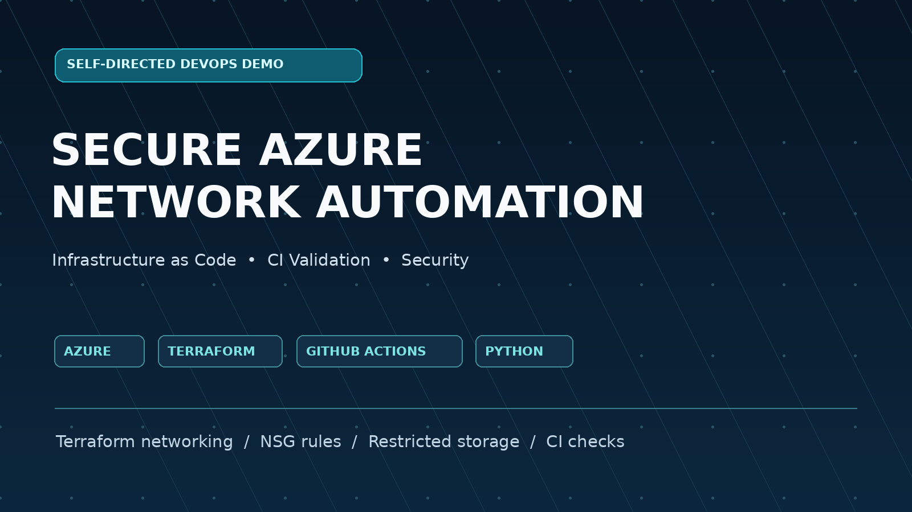
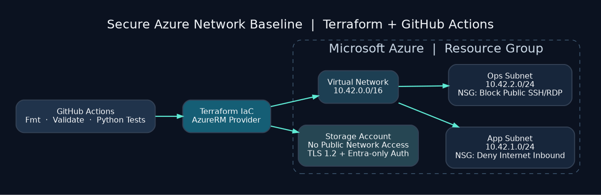

# Secure Azure Network Automation | Terraform + GitHub Actions

[](https://github.com/ftariq-tech/azure-secure-devops-portfolio/actions/workflows/terraform-checks.yml)

**Independent Cloud & DevOps Portfolio Project.** This project demonstrates secure Azure infrastructure automation using Terraform, GitHub Actions, and Python. The CI pipeline has successfully passed Terraform validation and automated tests. Azure deployment has not yet been performed.



## What this project demonstrates

| Skill | Practical example |
|---|---|
| Azure Infrastructure | Resource Group, Virtual Network, two segmented subnets |
| Cloud security | Network Security Groups and restricted storage account defaults |
| Infrastructure as Code | Terraform files with variables, tags and outputs |
| CI/CD validation | GitHub Actions: `fmt`, `init -backend=false`, `validate` |
| Python automation | IPv4 CIDR overlap/containment validator and unit tests |
| Documentation | Architecture, manual runbook, verification checklist |

## Architecture



Terraform also uses the `random` provider for a storage-account name suffix, to reduce naming collisions. The configuration defines a VNet (`10.42.0.0/16`) with app (`10.42.1.0/24`) and ops (`10.42.2.0/24`) subnets. The app subnet's NSG explicitly blocks inbound traffic from the Azure `Internet` service tag; the operations subnet explicitly blocks inbound SSH/RDP from Internet. These defense-in-depth rules are **not** a replacement for a full security review. The storage account denies public network access, uses TLS 1.2, disables public blob access and shared-key authorization. It is intentionally inaccessible for data operations until an authorized private endpoint and appropriate Microsoft Entra data access permissions are configured.

No virtual machines, public IP addresses or applications are provisioned. The default CI pipeline does **not** authenticate to Azure, run `terraform plan`, or deploy resources.

## Files

```text
.github/workflows/terraform-checks.yml    GitHub Actions CI checks
main.tf                                 Azure resources / security defaults
variables.tf                            Parameter definitions
outputs.tf                              Outputs (no credentials)
versions.tf                             AzureRM Terraform provider
terraform.tfvars.example                Example inputs (NOT real credentials)
scripts/validate_cidrs.py               Python network-range checker
tests/test_validate_cidrs.py            Python unit tests
docs/architecture.png                   Architecture diagram
docs/portfolio-cover.png                Portfolio cover
docs/RESUME_ENTRY.md                    CV-ready project description
docs/UPWORK_PORTFOLIO.md                Future portfolio text
docs/VALIDATION_LOG.md                  Honest evidence checklist
```

## 1. Run Python checks without an Azure account

```bash
python3 scripts/validate_cidrs.py
python3 -m unittest discover -s tests -v
```

The sample network ranges are intentionally repeated in CI so the script validates the **default design**, not arbitrary Terraform variable overrides. Check any custom CIDRs separately by supplying CLI arguments to `validate_cidrs.py`.

## 2. Validate Terraform locally (no Azure resource deployment)

Install [Terraform](https://developer.hashicorp.com/terraform/install) and run in the repository directory:

```bash
terraform fmt -check -recursive
terraform init -backend=false -input=false
terraform validate -no-color
```

The init step downloads the AzureRM provider; an internet connection is required. These checks do not deploy anything and normally do not require Azure login.

## 3. Optional Azure demo (only in an account you are allowed to use)

Azure resources can incur charges, including a storage account even with little or no data. Inspect costs and obtain permission first. Install Azure CLI and sign in to a test subscription you control or are authorized to use.

```bash
az login
az account set --subscription YOUR_SUBSCRIPTION_ID
cp terraform.tfvars.example terraform.tfvars
# Edit terraform.tfvars and replace the subscription ID placeholder.
terraform init
terraform plan -out=demo.tfplan
# Review changes before proceeding. Apply is OPTIONAL.
terraform apply demo.tfplan
```

On Windows PowerShell, replace `cp` with `Copy-Item`, if needed. If you deployed the demo, verify resource settings in Azure and capture screenshots that exclude account IDs and sensitive information. Clean up when finished:

```bash
terraform destroy
```

**Keep the state file until destroy succeeds.** Always verify resources were actually removed in the Azure portal. Do not upload `terraform.tfvars`, state, saved plans, credentials or tokens. The `.gitignore` reduces accidental publication risk but does not replace a manual review.

## CI/CD Validation Results

The project includes an automated GitHub Actions CI pipeline to validate infrastructure configurations and network security checks.

**Successfully Completed:**
- Terraform formatting validation
- Terraform provider initialization
- Terraform configuration validation
- Azure subnet CIDR validation using Python
- Automated Python unit tests

**CI Pipeline Status:** Passed

**Deployment Status:** Infrastructure code validated; Azure deployment not yet performed.

**Technologies:** Microsoft Azure, Terraform, GitHub Actions, Python, Infrastructure as Code (IaC).

[View Successful CI Pipeline](https://github.com/ftariq-tech/azure-secure-devops-portfolio/actions/runs/41326172713)
## Scope and limitations

-Terraform formatting, initialization, configuration validation, CIDR checks, and Python unit tests have passed successfully in GitHub Actions. Azure resources have not been deployed.
- No storage private endpoint exists; the storage account is intentionally locked down and cannot be used for data traffic until one is added.
- The network CIDR Python checker is a design check, **not** a substitute for IaC policy scanning or a security audit.
- A real production implementation would add remote Terraform state, approved identities, network access design, audit logging, cost monitoring and formal security tests.
- Cite this honestly as a **self-directed portfolio project**, not paid customer experience.
